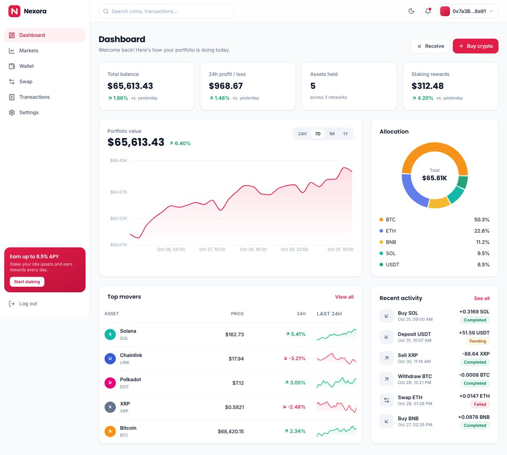
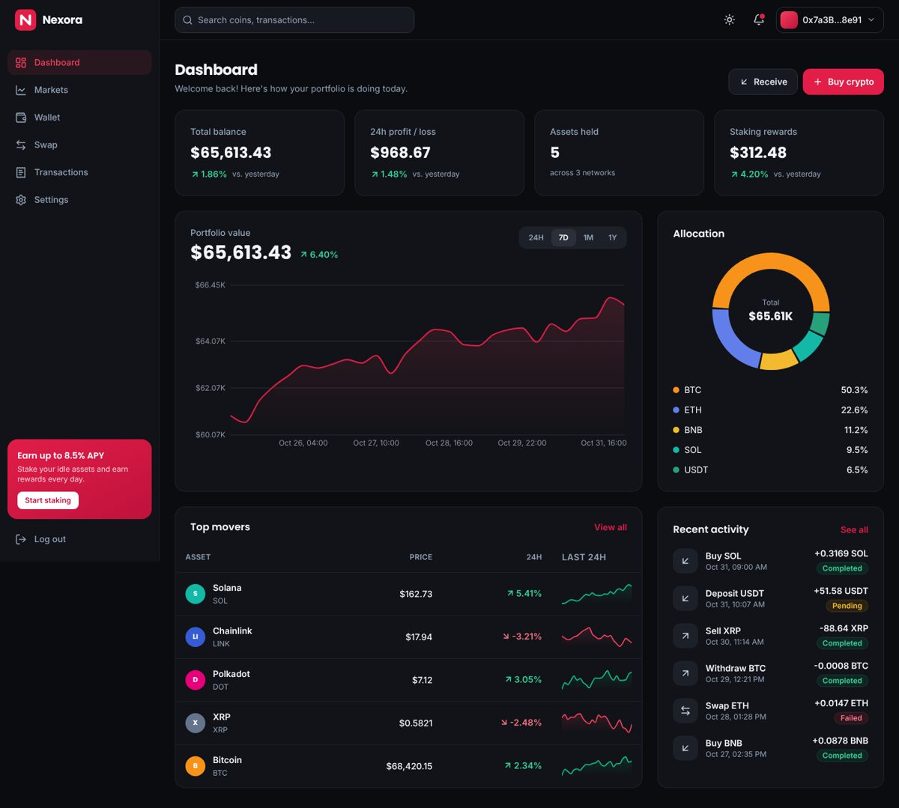
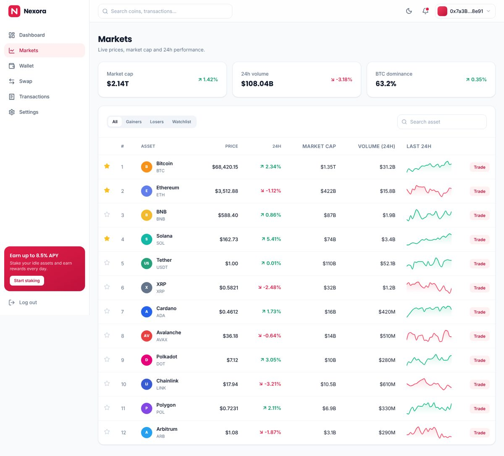
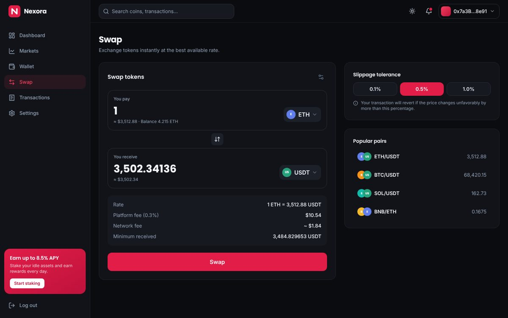
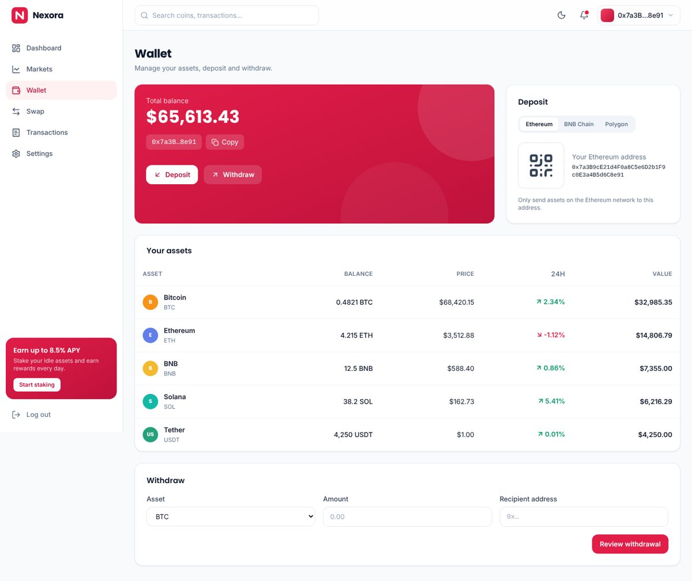
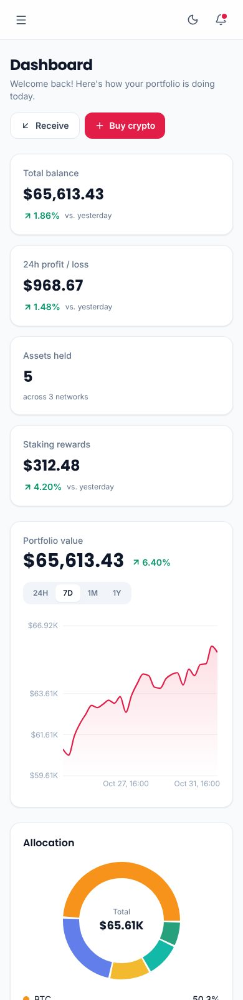

<div align="center">


# Nexora

**A free, open-source crypto & Web3 dashboard template built with React, TypeScript and Tailwind CSS.**

[**Live demo**](https://rahimixyz.github.io/nexora/) · [Documentation](documentation/index.html) · [Report a bug](https://github.com/rahimixyz/nexora/issues)




</div>

## Features

- **10 pages:** Dashboard, Markets, Coin detail, Wallet, Swap, Transactions, Settings, Login, Register and 404
- **Light and dark mode**, remembered in the browser
- **5 accent colors** (red, blue, violet, emerald, amber), switchable at runtime
- **Fully responsive** on mobile, tablet and desktop
- **Interactive charts:** portfolio history (24H / 7D / 1M / 1Y), allocation donut and sparklines
- **Markets table** with search, gainers and losers tabs, and a watchlist
- **Swap UI** with rate, fee breakdown, slippage and popular pairs
- **Transactions** with filters, pagination and CSV export
- **No backend needed:** build once and host anywhere (GitHub Pages, Netlify, Vercel, cPanel, IPFS)
- **Self-hosted fonts:** no external requests to Google Fonts
- Typed demo data that's easy to replace with your own API

## Screenshots

| Dark mode | Markets |
|---|---|
|  |  |
| **Swap** | **Wallet** |
|  |  |

<p align="center"></p>

## Quick start

Requires [Node.js](https://nodejs.org) 20.19 or newer.

```bash
git clone https://github.com/rahimixyz/nexora.git
cd nexora
npm install
npm run dev
```

Open http://localhost:5173.

| Command | What it does |
|---|---|
| `npm run dev` | Start the dev server with hot reload |
| `npm run build` | Production build into `dist/` |
| `npm run build:demo` | Build into `docs/` for GitHub Pages |
| `npm run preview` | Preview the production build |

## Deployment

Run `npm run build` and upload the contents of `dist/` to any static host. Nexora uses hash routing (`/#/markets`) and relative paths, so it works in any folder with no server configuration.

## Customization

| What | Where |
|---|---|
| Logo and name | `src/components/Logo.tsx`, `public/favicon.svg`, `index.html` |
| Brand color presets | `src/index.css` and `ACCENTS` in `src/context/ThemeContext.tsx` |
| Default theme and accent | `ThemeProvider` in `src/context/ThemeContext.tsx` |
| Demo data | `src/data/mock.ts` |
| Swap platform fee | `FEE` in `src/pages/Swap.tsx` |

See the full [documentation](documentation/index.html) for details.

> **Note:** Nexora is a front-end template. It has no backend, smart contracts or real trading logic. All prices, balances and transactions are demo data.

## Tech stack

[React](https://react.dev) · [TypeScript](https://www.typescriptlang.org) · [Vite](https://vite.dev) · [Tailwind CSS](https://tailwindcss.com) · [React Router](https://reactrouter.com) · [Recharts](https://recharts.org) · [Lucide](https://lucide.dev) · [Fontsource](https://fontsource.org)

## Contributing

Issues and pull requests are welcome. If Nexora helps you, a ⭐ on the repo is appreciated.

## Custom development

Need a backend, a real exchange or a custom version built on Nexora? Reach **NETXYZ** through [CodeCanyon](https://codecanyon.net/user/netxyz).

## License

[MIT](LICENSE) © 2026 NETXYZ
